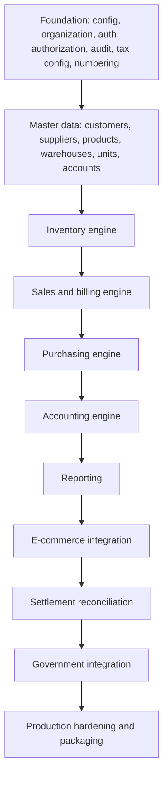

# CommerceBill Desktop - Architecture (Phase 0)

Authoritative source: `COMMERCEBILL_MASTER_SPEC_V2.md` (the "spec"). Section numbers below refer to it.
Status of every item is tracked in [PROJECT_STATE.md](PROJECT_STATE.md) and
[REQUIREMENTS_MATRIX.md](REQUIREMENTS_MATRIX.md).

## 1. Product scope (concise)

A local-first, offline-capable Windows desktop application for small Indian e-commerce businesses:
GST billing, inventory (append-only stock ledger), purchases, double-entry accounting,
online/offline order management, marketplace settlement reconciliation, reporting, import/export,
audit logging and backup/restore. Core flows never require internet. Marketplace, e-invoice,
e-way bill, e-mail, WhatsApp Business and update features are optional and isolated behind provider
interfaces. Work proceeds through gated phases 0-6 (spec section 8); only Phase 0 is in scope now.

## 2. Assumptions

1. Primary user runs Windows 11 on one local computer; LAN/cloud sync is a future concern.
2. Business is in India, INR, English; GST registered or not; sells through multiple channels.
3. Core operation must not depend on paid cloud services.
4. Live marketplace/government integrations need external approval, credentials and contracts that
   are not available; they will be built against mocks/sandboxes and marked
   `NOT VERIFIED AGAINST LIVE SERVICE`.
5. Everyday operation must not need administrator rights.
6. The data model is multi-organization from day one even though the UI shows one organization.
7. Versions of tooling are those installed on 2026-10-16 (see ADR-0002).

## 3. Compliance items requiring professional verification

The application must never claim legal, GST or statutory compliance (spec section 4). A qualified
accountant/tax professional must verify before production use:

- GST rates, HSN/SAC mapping, place-of-supply and reverse-charge rules, thresholds (all configurable and
  effective-dated).
- Invoice mandatory-field set, numbering/series policy, and financial-year reset policy.
- Round-off policy and tax-inclusive price handling.
- GSTR-1 / GSTR-3B preparation report formats (supporting reports only).
- E-invoice (IRN/ack/signed QR) and e-way bill applicability and provider formats - official only when an
  authorized portal/provider returns them; no identifiers are ever fabricated.
- TCS/TDS treatment on marketplace settlements.
- Data-retention periods for records and audit logs.

## 4. Proposed architecture

```
+------------------------------ Windows desktop ------------------------------+
|  Electron main process (apps/desktop)                                       |
|    - window + security policy, single-instance lock, minimal IPC           |
|    - [Phase 1+] supervises local API + PostgreSQL lifecycle                 |
|          |  preload bridge (contextIsolation, sandbox, no nodeIntegration)  |
|  Renderer: React + TS + Vite + Tailwind (apps/web)                          |
|          |  HTTP over loopback only (127.0.0.1), CORS-restricted            |
|  API: Node + Fastify + Zod (apps/api)  - thin routes                        |
|          |  calls                                                          |
|  Domain packages (pure TypeScript, no I/O, no UI/provider types)            |
|    tax-engine  accounting-engine  inventory-engine  document-engine        |
|    domain  validation  shared-types  reporting  integration-core           |
|          |  repositories / explicit transactions                           |
|  packages/database: Prisma 7 + driver adapter (pg)                          |
|          |                                                                  |
|  PostgreSQL (loopback-only; data dir outside install dir)                   |
+-----------------------------------------------------------------------------+
Optional, behind provider interfaces: marketplaces, e-invoice, e-way bill, e-mail, WhatsApp Business.
```

Key rules: business logic lives only in domain packages (never UI, routes or providers); providers
normalize external data before calling domain services; the server recalculates all totals; posting
and numbering share one database transaction.

## 5. Major architecture decisions

See [docs/adr/](adr/). Summary:

| ADR  | Decision                                                                                                                                   |
| ---- | ------------------------------------------------------------------------------------------------------------------------------------------ |
| 0001 | npm workspaces monorepo; domain logic in packages, apps are thin                                                                           |
| 0002 | Toolchain versions and the TypeScript 6.0 pin (typescript-eslint support)                                                                  |
| 0003 | PostgreSQL via embedded-postgres for dev/test; Docker optional; bundling for production decided in Phase 6                                 |
| 0004 | Money is exact decimal everywhere (DB `Decimal`, `decimal.js` in domain)                                                                   |
| 0005 | Prisma 7 with driver adapter; schema at `prisma/schema.prisma`; hand-written SQL appended to migrations where Prisma cannot express a rule |
| 0006 | Electron hardening baseline                                                                                                                |
| 0007 | Append-only audit log enforced by database triggers                                                                                        |
| 0008 | Loopback-only API and env validation                                                                                                       |

## 6. Module dependency map (spec section 7)



Constraints: no marketplace connector before the canonical order/product/customer/tax/inventory/payment
models are stable; no financial report before postings are balanced and traceable; no live government
connector before the tax-document model and provider abstraction are stable.

## 7. Phased roadmap

| Phase | Theme                         | Gate summary                                                                                         |
| ----- | ----------------------------- | ---------------------------------------------------------------------------------------------------- |
| 0     | Architecture and foundation   | Install, type-check, lint, tests, test DB, migration, Electron starts, API health, docs (this phase) |
| 1     | Billing foundation MVP        | Setup wizard, auth/RBAC, customers/products/stock, invoices + PDF, payments, backup/restore          |
| 2     | Purchases and accounting      | Suppliers, POs, bills, double-entry journals, trial balance, P&L, period locks                       |
| 3     | E-commerce operations         | Canonical orders, providers (mock/sandbox), fulfilment, returns, credit notes                        |
| 4     | Settlement and reconciliation | Marketplace/gateway settlements, matching, fees, profitability                                       |
| 5     | Advanced India compliance     | E-invoice/e-way bill providers, GSTR preparation reports                                             |
| 6     | Production hardening          | Installer, upgrade, security review, SBOM, performance, release report                               |

A phase starts only when the previous phase's exit criteria pass.

## 8. Initial database-domain map

Full domain map, Mermaid ER diagram and per-table design are in [DATABASE_SCHEMA.md](DATABASE_SCHEMA.md).
Phase 0 implements only the Foundation domain in `prisma/schema.prisma`; the other domains are designed
(naming and relationships fixed) but not created.

## 9. Repository tree (Phase 0)

```
/
|-- apps/
|   |-- api/            Fastify API (health checks, error contract, security headers)
|   |-- web/            React + Vite + Tailwind renderer
|   `-- desktop/        Electron main/preload, security policy
|-- packages/
|   |-- database/       Prisma client factory + generated client (generated/ is git-ignored)
|   |-- shared-types/   Error codes, API contracts, bridge types
|   |-- validation/     Environment schema (Zod)
|   |-- test-utilities/ Throwaway PostgreSQL cluster + isolated-database helpers
|   `-- domain, tax-engine, accounting-engine, inventory-engine,
|       document-engine, integration-core, ui, reporting   (README only - NOT STARTED)
|-- prisma/             schema.prisma, migrations/, seed/{reference,demo}
|-- templates/, integrations/, sample-data/, sample-imports/   (reserved, NOT STARTED)
|-- tests/              unit, integration, e2e, security, migration, recovery
|-- scripts/            dev, db-start, db-migrate, verify-phase0
|-- docs/               state, matrix, risks, ADRs, schema, conventions, threat model
`-- docker-compose.yml  OPTIONAL developer PostgreSQL
```

## 10. Phase 0 acceptance criteria

From spec section 8, Phase 0 exit criteria (results recorded in
[PHASE_0_COMPLETION_REPORT.md](PHASE_0_COMPLETION_REPORT.md)):

1. Repository installs successfully.
2. TypeScript compilation succeeds (strict).
3. Linting succeeds.
4. Test runner executes.
5. Test database starts.
6. Initial migration succeeds.
7. Electron shell starts.
8. API health check succeeds.
9. Project documentation is initialized.

## 11. Specification contradictions and tensions

No blocking contradiction was found. Tensions that need decisions in later phases:

1. **PostgreSQL vs "no Docker, non-technical user, no admin rights".** The installer must ship and
   supervise a PostgreSQL instance. `embedded-postgres` proves this works in development; packaging,
   licensing notices and service lifecycle are Phase 6 work (ADR-0003, risk R-030).
2. **Backups need `pg_dump`/`pg_restore`, which the embedded binaries do not include** (verified: only
   `initdb`, `pg_ctl`, `postgres` and libraries ship). Phase 1 must either bundle the client tools or
   implement a verified logical export (risk R-031). Resolved in Task 1.17: see ADR-0027 and packages/backup.
3. **Loopback API is still reachable by other local processes/users.** Loopback-only is necessary but not
   sufficient; Phase 1 needs per-session authentication and a per-launch secret between the Electron
   shell and the API (risk R-032).
4. **Argon2id is a native module** and must be rebuilt/prebuilt for Electron's Node ABI (risk R-033).
5. **Latest TypeScript (7.x) is not yet supported by typescript-eslint**; pinned to 6.0 (ADR-0002).
6. **Two stock valuation methods (FIFO and weighted average)** are both requested; Phase 1 must pick a
   per-organization setting and test both, or defer one explicitly.
