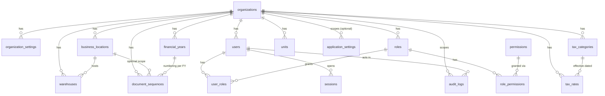
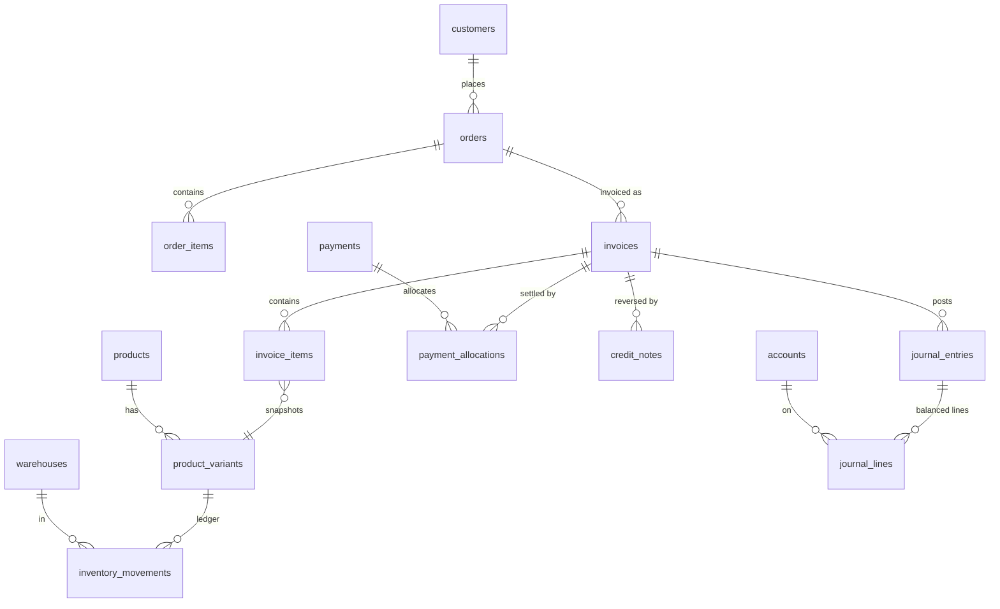

# Database Schema

Source of truth: [`prisma/schema.prisma`](../prisma/schema.prisma) and `prisma/migrations/`.
Conventions: [DATABASE_CONVENTIONS.md](DATABASE_CONVENTIONS.md).

**Implemented (18 tables since Phase 0; Task 1.1 added columns only):** the Foundation domain only. All other domains below are
_designed_ (names and relationships reserved from spec section 34) and are created by the phase that owns
them. Nothing in this file about an unimplemented domain should be read as existing code.

## 1. Domain map

| Domain                  | Tables (spec section 34)                                                                                                                                                                                                      | Phase                     | Status             |
| ----------------------- | ----------------------------------------------------------------------------------------------------------------------------------------------------------------------------------------------------------------------------- | ------------------------- | ------------------ |
| Foundation              | organizations, organization_settings, business_locations, financial_years, warehouses, users, roles, permissions, user_roles, role_permissions, sessions, document_sequences, tax_rates, tax_categories, hsn_sac_codes, units | 0 (tables), 1 (behaviour) | **Tables created** |
| System                  | audit_logs, application_settings                                                                                                                                                                                              | 0                         | **Tables created** |
| System (later)          | attachments, import_batches, import_rows, export_history, backup_history, restore_history, notifications, migration_history                                                                                                   | 1 / 6                     | Designed           |
| Master data             | customers, customer_addresses, customer_contacts, suppliers, supplier_addresses, categories, brands, products, product_variants, product_attributes, product_barcodes, product_prices, marketplace_product_mappings           | 1 (suppliers: 2)          | Designed           |
| Inventory               | inventory_balances, inventory_movements, stock_reservations, stock_transfers(+lines), stock_counts(+lines), batches, serial_numbers, bundle_components                                                                        | 1                         | Designed           |
| Sales                   | orders(+items, status_history), quotations(+items), invoices(+items, status_history), delivery_challans(+items), credit_notes(+items), debit_notes(+items), shipments(+items)                                                 | 1, 3                      | Designed           |
| Returns                 | returns(+items), return_inspections, replacement_orders, refund_records                                                                                                                                                       | 3                         | Designed           |
| Purchasing              | purchase_orders(+items), goods_receipts(+items), purchase_bills(+items), purchase_returns(+items)                                                                                                                             | 2                         | Designed           |
| Payments and accounting | payment_methods, payments, payment_allocations, expenses, expense_categories, bank_accounts, accounts, journal_entries, journal_lines, accounting_periods                                                                     | 1 (payments), 2           | Designed           |
| Reconciliation          | reconciliation_batches, reconciliation_lines, reconciliation_matches, settlement_adjustments                                                                                                                                  | 4                         | Designed           |
| Integrations            | integrations, integration_credentials, integration_mappings, sync_runs, sync_checkpoints, sync_errors, webhook_events                                                                                                         | 3, 5                      | Designed           |

## 2. ER diagram

### 2.1 Implemented foundation (Phase 0)

### 2.2 Planned core transaction flow (designed, NOT implemented)

## 3. Data dictionary - implemented tables

Legend: PK primary key, FK foreign key, UQ unique, CK check. Every table has `created_at` unless noted;
`updated_at` and `version` (optimistic concurrency, starts at 1) exist on mutable tables.
All FKs use `ON DELETE RESTRICT` unless noted (history is never silently cascaded away).

| Table                 | Org scope                                         | Key columns and rules                                                                                                                                                                            | Soft delete                | Retention / audit notes                                                      |
| --------------------- | ------------------------------------------------- | ------------------------------------------------------------------------------------------------------------------------------------------------------------------------------------------------ | -------------------------- | ---------------------------------------------------------------------------- |
| organizations         | self                                              | PK id; `gst_status` enum; `pan` varchar(10), `gstin` varchar(15) (format validation in app, Phase 1); `setup_step`/`setup_completed_at` make the wizard resumable; `is_demo_data`                | `is_active`                | Never deleted once transactions exist; audit all changes                     |
| organization_settings | `organization_id`                                 | UQ (organization_id, key); `value` JSON                                                                                                                                                          | no                         | Tax/branding keys are audited                                                |
| business_locations    | `organization_id`                                 | UQ (org, name); partial UQ: one `is_primary` per org                                                                                                                                             | `is_active`                | Address snapshots are copied onto posted documents                           |
| financial_years       | `organization_id`                                 | UQ (org, label); CK end_date > start_date; `is_locked`                                                                                                                                           | no                         | Locking/unlocking audited with reason (Phase 2)                              |
| warehouses            | `organization_id`                                 | UQ (org, code); FK location optional; partial UQ: one primary per org                                                                                                                            | `is_active`                | Referenced by stock ledger (Phase 1) so never deleted                        |
| users                 | `organization_id`                                 | UQ (org, username); `password_hash` (Argon2id, Phase 1); lockout fields; `is_demo_user`                                                                                                          | `is_active`                | Privilege changes audited; hashes never logged                               |
| roles                 | `organization_id`                                 | UQ (org, name); `is_system` for the 5 templates                                                                                                                                                  | no                         | System roles not deletable                                                   |
| permissions           | global                                            | UQ key (e.g. `sales.invoice.post`)                                                                                                                                                               | no                         | Catalogue defined by the application                                         |
| user_roles            | via user/role                                     | PK (user_id, role_id); cascade on user delete                                                                                                                                                    | no                         | Assignment changes audited                                                   |
| role_permissions      | via role                                          | PK (role_id, permission_id); cascade on role delete                                                                                                                                              | no                         | Changes audited                                                              |
| sessions              | via user                                          | UQ `token_hash` (SHA-256 of token); expires_at, revoked_at                                                                                                                                       | revoked_at                 | Purge expired rows periodically                                              |
| document_sequences    | `organization_id`                                 | UQ (org, location, FY, document_type) + partial UQ when location is NULL; CK numeric_length 1-18, start >= 1, last >= 0; `last_number` BigInt advanced under row lock in the posting transaction | no                         | Numbers are never reused; gap report in Phase 1                              |
| tax_categories        | `organization_id`                                 | UQ (org, code); CK classification in (STANDARD, NIL_RATED, EXEMPT, ZERO_RATED, NON_GST)                                                                                                          | `is_active`                | Changes audited                                                              |
| tax_rates             | `organization_id`                                 | UQ (category, effective_from); `rate_percent`/`cess_percent` Decimal(7,4); CK 0-100 and effective_to >= effective_from                                                                           | no (append, close old row) | Posted documents keep their own snapshot                                     |
| hsn_sac_codes         | global                                            | UQ code varchar(8); CK kind in (HSN, SAC)                                                                                                                                                        | no                         | User-maintained; no official data bundled                                    |
| units                 | `organization_id`                                 | UQ (org, code); CK decimal_places 0-4                                                                                                                                                            | `is_active`                | -                                                                            |
| audit_logs            | `organization_id` (nullable for pre-setup events) | Append-only: row triggers block UPDATE/DELETE, statement trigger blocks TRUNCATE; indexes (org, occurred_at), (entity_type, entity_id), (user, occurred_at)                                      | never                      | Retention policy decided with an accountant; archival must itself be audited |
| application_settings  | `organization_id` nullable                        | UQ (org, key) + partial UQ for global keys                                                                                                                                                       | no                         | -                                                                            |

### 3.1 Changes in migration `20261017000000_task_1_1_tax_reference_markers` (Task 1.1)

- `tax_categories`: + `effective_from`, `effective_to` (nullable dates; CK `effective_to >= effective_from`),
  `origin` (`USER` | `REFERENCE_SEED`), `review_status` (`UNREVIEWED` | `REVIEWED`), `review_note`.
- `tax_rates`: + `origin`, `review_status`, `review_note` (same checks).
- Existing rows receive `origin=USER`, `review_status=UNREVIEWED`, no effective dates (covered by a
  populated-database migration test). Seeded values are placeholders that require accountant review (ADR-0012).

### 3.2 Changes in migration `20261018000000_task_1_3_auth_constraints` (Task 1.3)

No table or column changes (`schema.prisma` unchanged). Constraints and a trigger only:
`users_username_form_chk` (lower-case, trimmed, 3-64 chars; existing names are folded first and the migration
aborts atomically on a collision), `sessions_token_hash_form_chk` (token_hash must be 64 lower-case hex, so a raw
token cannot be stored), `sessions_expiry_chk` (expires_at > created_at), and trigger `users_no_delete`
(users are disabled, never deleted).

### 3.3 Changes in migration `20261019000000_task_1_4_setup_invariants` (Task 1.4)

No table or column changes (`schema.prisma` unchanged). On `organizations`: format checks for PAN, GSTIN and state
code; the GST-status rules (registered requires a GSTIN, unregistered forbids one); GSTIN-state and GSTIN-PAN
consistency; and trigger `organizations_setup_completed_immutable` (once `setup_completed_at` is set it can never be
cleared or changed). Existing violating rows make the migration abort atomically. The setup draft lives in
`application_settings` (key `setup.draft`, global row).

## 4. Relationship explanation

- Everything business-related hangs off `organizations`, so multiple organizations can share one database.
- `document_sequences` is scoped by organization + optional location + financial year + document type so
  `INV/2026-27/000001` style numbers restart per financial year without collisions.
- `tax_rates` belong to `tax_categories` and are effective-dated; a rate change adds a row instead of editing
  one, protecting historical reporting (posted documents additionally store a calculation snapshot).
- `users` -> `user_roles` -> `roles` -> `role_permissions` -> `permissions` implements RBAC with granular
  permissions on top of the five role templates.
- `audit_logs` references users and organizations with `RESTRICT`, so audited actors cannot be deleted.

## 5. Index strategy

- Every FK that is filtered on has an index starting with `organization_id` where applicable.
- Time-ordered tables (`audit_logs`) index `(organization_id, occurred_at)`.
- Lookup keys (`permissions.key`, `sessions.token_hash`, `hsn_sac_codes.code`) are unique indexes.
- Partial unique indexes cover NULL-scoped uniqueness and "only one primary" rules.
- Future high-volume tables (stock ledger, journal lines, orders) will index by (organization, date) and by
  document reference; to be validated with the performance tests in Phase 6 (spec section 47).

## 6. Archival strategy (design intent)

Posted financial and stock records are retained indefinitely by default. Archival, if ever offered, will
move closed financial years to a read-only archive table set or export under an audited, administrator-only
procedure that preserves totals (opening-balance journals) and never alters posted documents. Sessions and
sync/diagnostic logs have short retention; audit logs follow a retention period chosen with the business's
accountant. No archival code exists in Phase 0.

## 7. Phase 0 limitations

- No seed rows yet (permission catalogue, role templates, default units/tax categories are Phase 1).
- `migration_history` (application-level) is not created; Prisma's `_prisma_migrations` table is used until
  Phase 6 defines upgrade tracking.
- Row-level multi-organization isolation is by convention (`organization_id` on every query); there is no
  database row-level security.
