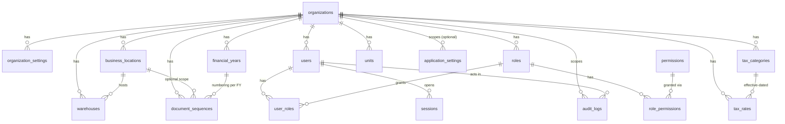
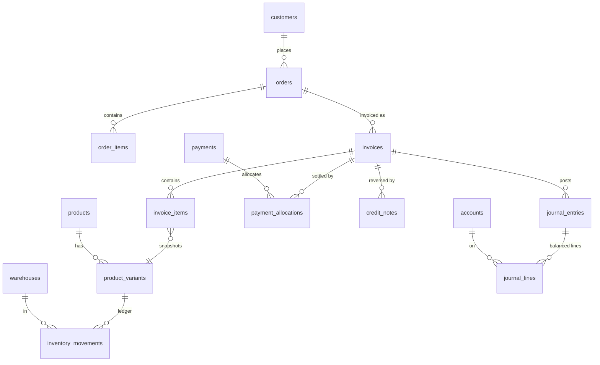

# Database Schema

Source of truth: [`prisma/schema.prisma`](../prisma/schema.prisma) and `prisma/migrations/`.
Conventions: [DATABASE_CONVENTIONS.md](DATABASE_CONVENTIONS.md).

**Implemented (19 tables: 18 from Phase 0 plus `document_number_allocations` in Task 1.5):** the Foundation domain only. All other domains below are
_designed_ (names and relationships reserved from spec section 34) and are created by the phase that owns
them. Nothing in this file about an unimplemented domain should be read as existing code.

## 1. Domain map

| Domain                  | Tables (spec section 34)                                                                                                                                                                                                      | Phase                     | Status             |
| ----------------------- | ----------------------------------------------------------------------------------------------------------------------------------------------------------------------------------------------------------------------------- | ------------------------- | ------------------ |
| Foundation              | organizations, organization_settings, business_locations, financial_years, warehouses, users, roles, permissions, user_roles, role_permissions, sessions, document_sequences, tax_rates, tax_categories, hsn_sac_codes, units | 0 (tables), 1 (behaviour) | **Tables created** |
| System                  | audit_logs, application_settings                                                                                                                                                                                              | 0                         | **Tables created** |
| System (later)          | attachments, import_batches, import_rows, export_history, backup_history, restore_history, notifications, migration_history                                                                                                   | 1 / 6                     | Designed           |
| Master data             | customers, customer_addresses, customer_contacts, suppliers, supplier_addresses, categories, brands, products, product_variants, product_attributes, product_barcodes, product_prices, marketplace_product_mappings           | 1 (suppliers: 2)          | Designed           |
| Inventory               | inventory_balances, inventory_movements, stock_reservations, stock_transfers(+lines), stock_counts(+lines), batches, serial_numbers, bundle_components                                                                        | 1                         | Designed           |
| Sales                   | orders(+items, status_history), quotations(+items), invoices(+items, status_history), delivery_challans(+items), credit_notes(+items), debit_notes(+items), shipments(+items)                                                 | 1, 3                      | Designed           |
| Returns                 | returns(+items), return_inspections, replacement_orders, refund_records                                                                                                                                                       | 3                         | Designed           |
| Purchasing              | purchase_orders(+items), goods_receipts(+items), purchase_bills(+items), purchase_returns(+items)                                                                                                                             | 2                         | Designed           |
| Payments and accounting | payment_methods, payments, payment_allocations, expenses, expense_categories, bank_accounts, accounts, journal_entries, journal_lines, accounting_periods                                                                     | 1 (payments), 2           | Designed           |
| Reconciliation          | reconciliation_batches, reconciliation_lines, reconciliation_matches, settlement_adjustments                                                                                                                                  | 4                         | Designed           |
| Integrations            | integrations, integration_credentials, integration_mappings, sync_runs, sync_checkpoints, sync_errors, webhook_events                                                                                                         | 3, 5                      | Designed           |

## 2. ER diagram

### 2.1 Implemented foundation (Phase 0)

### 2.2 Planned core transaction flow (designed, NOT implemented)

## 3. Data dictionary - implemented tables

Legend: PK primary key, FK foreign key, UQ unique, CK check. Every table has `created_at` unless noted;
`updated_at` and `version` (optimistic concurrency, starts at 1) exist on mutable tables.
All FKs use `ON DELETE RESTRICT` unless noted (history is never silently cascaded away).

| Table                 | Org scope                                         | Key columns and rules                                                                                                                                                                            | Soft delete                | Retention / audit notes                                                      |
| --------------------- | ------------------------------------------------- | ------------------------------------------------------------------------------------------------------------------------------------------------------------------------------------------------ | -------------------------- | ---------------------------------------------------------------------------- |
| organizations         | self                                              | PK id; `gst_status` enum; `pan` varchar(10), `gstin` varchar(15) (format validation in app, Phase 1); `setup_step`/`setup_completed_at` make the wizard resumable; `is_demo_data`                | `is_active`                | Never deleted once transactions exist; audit all changes                     |
| organization_settings | `organization_id`                                 | UQ (organization_id, key); `value` JSON                                                                                                                                                          | no                         | Tax/branding keys are audited                                                |
| business_locations    | `organization_id`                                 | UQ (org, name); partial UQ: one `is_primary` per org                                                                                                                                             | `is_active`                | Address snapshots are copied onto posted documents                           |
| financial_years       | `organization_id`                                 | UQ (org, label); CK end_date > start_date; `is_locked`                                                                                                                                           | no                         | Locking/unlocking audited with reason (Phase 2)                              |
| warehouses            | `organization_id`                                 | UQ (org, code); FK location optional; partial UQ: one primary per org                                                                                                                            | `is_active`                | Referenced by stock ledger (Phase 1) so never deleted                        |
| users                 | `organization_id`                                 | UQ (org, username); `password_hash` (Argon2id, Phase 1); lockout fields; `is_demo_user`                                                                                                          | `is_active`                | Privilege changes audited; hashes never logged                               |
| roles                 | `organization_id`                                 | UQ (org, name); `is_system` for the 5 templates                                                                                                                                                  | no                         | System roles not deletable                                                   |
| permissions           | global                                            | UQ key (e.g. `sales.invoice.post`)                                                                                                                                                               | no                         | Catalogue defined by the application                                         |
| user_roles            | via user/role                                     | PK (user_id, role_id); cascade on user delete                                                                                                                                                    | no                         | Assignment changes audited                                                   |
| role_permissions      | via role                                          | PK (role_id, permission_id); cascade on role delete                                                                                                                                              | no                         | Changes audited                                                              |
| sessions              | via user                                          | UQ `token_hash` (SHA-256 of token); expires_at, revoked_at                                                                                                                                       | revoked_at                 | Purge expired rows periodically                                              |
| document_sequences    | `organization_id`                                 | UQ (org, location, FY, document_type) + partial UQ when location is NULL; CK numeric_length 1-18, start >= 1, last >= 0; `last_number` BigInt advanced under row lock in the posting transaction | no                         | Numbers are never reused; gap report in Phase 1                              |
| tax_categories        | `organization_id`                                 | UQ (org, code); CK classification in (STANDARD, NIL_RATED, EXEMPT, ZERO_RATED, NON_GST)                                                                                                          | `is_active`                | Changes audited                                                              |
| tax_rates             | `organization_id`                                 | UQ (category, effective_from); `rate_percent`/`cess_percent` Decimal(7,4); CK 0-100 and effective_to >= effective_from                                                                           | no (append, close old row) | Posted documents keep their own snapshot                                     |
| hsn_sac_codes         | global                                            | UQ code varchar(8); CK kind in (HSN, SAC)                                                                                                                                                        | no                         | User-maintained; no official data bundled                                    |
| units                 | `organization_id`                                 | UQ (org, code); CK decimal_places 0-4                                                                                                                                                            | `is_active`                | -                                                                            |
| audit_logs            | `organization_id` (nullable for pre-setup events) | Append-only: row triggers block UPDATE/DELETE, statement trigger blocks TRUNCATE; indexes (org, occurred_at), (entity_type, entity_id), (user, occurred_at)                                      | never                      | Retention policy decided with an accountant; archival must itself be audited |
| application_settings  | `organization_id` nullable                        | UQ (org, key) + partial UQ for global keys                                                                                                                                                       | no                         | -                                                                            |

### 3.1 Changes in migration `20261017000000_task_1_1_tax_reference_markers` (Task 1.1)

- `tax_categories`: + `effective_from`, `effective_to` (nullable dates; CK `effective_to >= effective_from`),
  `origin` (`USER` | `REFERENCE_SEED`), `review_status` (`UNREVIEWED` | `REVIEWED`), `review_note`.
- `tax_rates`: + `origin`, `review_status`, `review_note` (same checks).
- Existing rows receive `origin=USER`, `review_status=UNREVIEWED`, no effective dates (covered by a
  populated-database migration test). Seeded values are placeholders that require accountant review (ADR-0012).

### 3.2 Changes in migration `20261018000000_task_1_3_auth_constraints` (Task 1.3)

No table or column changes (`schema.prisma` unchanged). Constraints and a trigger only:
`users_username_form_chk` (lower-case, trimmed, 3-64 chars; existing names are folded first and the migration
aborts atomically on a collision), `sessions_token_hash_form_chk` (token_hash must be 64 lower-case hex, so a raw
token cannot be stored), `sessions_expiry_chk` (expires_at > created_at), and trigger `users_no_delete`
(users are disabled, never deleted).

### 3.3 Changes in migration `20261019000000_task_1_4_setup_invariants` (Task 1.4)

No table or column changes (`schema.prisma` unchanged). On `organizations`: format checks for PAN, GSTIN and state
code; the GST-status rules (registered requires a GSTIN, unregistered forbids one); GSTIN-state and GSTIN-PAN
consistency; and trigger `organizations_setup_completed_immutable` (once `setup_completed_at` is set it can never be
cleared or changed). Existing violating rows make the migration abort atomically. The setup draft lives in
`application_settings` (key `setup.draft`, global row).

### 3.4 Changes in migration `20261020000000_task_1_5_document_numbering` (Task 1.5)

- `document_sequences`: + `reset_policy` (FINANCIAL_YEAR | NEVER), `is_active`; CHECKs for the stable document-type code
  form, reset policy, prefix/suffix length (<= 40) and start number fitting the width. Trigger: the counter may only
  advance by exactly one (first number = start number), organization/location/financial year/document type are
  immutable, the start number is frozen once a number is issued, and rows can never be deleted.
- New table `document_number_allocations` (append-only ledger): one row per issued number with the printed text frozen,
  `document_ref` (the document's internal id). Unique: (sequence, number), (organization, type, printed text),
  (organization, type, document_ref). A trigger rejects a row that does not match its sequence or exceeds its counter;
  UPDATE, DELETE and TRUNCATE are blocked.

### 3.5 Changes in migration `20261021000000_task_1_6_security_admin_invariant` (Task 1.6)

- No table or column changes (`schema.prisma` unchanged). Adds `organization_security_admin_count(org)` (active users
  holding BOTH `security.user.manage` and `security.role.manage` through roles of that organization) and the trigger
  function `enforce_security_administrator()`.
- Deferred CONSTRAINT TRIGGERs `users_keep_security_admin`, `user_roles_keep_security_admin`,
  `role_permissions_keep_security_admin`, `roles_keep_security_admin`, `permissions_keep_security_admin` fail the
  commit when an organization with a completed setup would be left with zero such users. The function takes
  `pg_advisory_xact_lock(hashtextextended('secadmin:' || org, 0))`, so concurrent transactions are checked one after
  another on fresh snapshots. Organizations with `setup_completed_at IS NULL` are exempt (R-060).

### 3.6 Changes in migration `20261022000000_task_1_9_customers` (Task 1.9)

- New table `customers`: internal UUID id; `organization_id` (FK, restrict); `code` (unique per organization, immutable); `customer_type` (B2C | B2B);
  names, contact person, e-mail, phones; `gst_status` (existing enum), `gstin`, `pan`; billing address (`billing_*`, state stored as the two-digit GST state code
  only, name derived from the reference list), `country`; `shipping_same_as_billing` plus nullable `shipping_*` columns used only when delivery differs;
  `place_of_supply_state_code` (a stored fact for the Task 1.12 tax engine); `credit_limit` numeric(14,2); `payment_terms_days`; `notes`; `is_active`;
  timestamps; `version`. Indexes: `(organization_id, is_active)`, `(organization_id, legal_name)`. CHECKs enforce code/GSTIN/PAN/state/PIN/country formats, the GST
  status rules (registered needs a GSTIN, unregistered forbids one, B2C is unregistered), credit-limit and payment-term ranges and shipping consistency. A partial unique
  index allows one GSTIN per organization. Trigger `customers_protect_identity` blocks DELETE and any change of id, organization, code or creation time.
- New table `customer_code_counters` (one row per organization, `last_number >= 0`) behind generated codes, advanced under a row lock inside the creating transaction.
- Existing tables and rows are untouched (tested against a populated Task 1.8 database).

### 3.7 Changes in migration `20261023000000_task_1_10_products` (Task 1.10)

- New table `products`: internal UUID id; `organization_id` (FK, restrict); `sku` (unique per organization, immutable); `name`, `description`; `kind` (GOODS | SERVICE, immutable);
  `hsn_sac_code_id` (FK to the global `hsn_sac_codes`, optional), `unit_id` (FK to `units`, required for goods), `tax_category_id` (FK to `tax_categories`, required);
  `mrp` and `selling_price` `numeric(18,2)`; `price_includes_tax`; `track_inventory`; `barcode` (unique per organization when present); `is_active`; timestamps; `version`.
  There is deliberately NO quantity or stock column (the Task 1.11 ledger will own stock) and NO tax rate (the Task 1.12 engine reads the effective-dated rates).
  CHECKs: sku and barcode formats, non-negative prices, goods have a unit, a service cannot track inventory, name present, version >= 1. Indexes: `(organization_id, is_active)`,
  `(organization_id, name)`. Trigger `products_protect_identity` blocks DELETE and any change of id, organization, sku, kind or creation time. Trigger `products_check_references`
  requires the unit and tax category to belong to the product's organization and the HSN/SAC code to be HSN for goods and SAC for services.
- New table `product_code_counters` (one row per organization, `last_number >= 0`) behind generated SKUs, advanced under a row lock inside the creating transaction.
- Existing tables and rows are untouched (tested against a populated Task 1.9 database).

### 3.8 Changes in migration `20261024000000_task_1_11_inventory` (Task 1.11)

- New table `stock_movements` (the append-only stock ledger; ADR-0022): internal UUID id; `organization_id`, `warehouse_id`, `product_id` (FKs, restrict); `movement_type`
  (OPENING_STOCK | STOCK_RECEIPT | ADJUSTMENT_INCREASE | ADJUSTMENT_DECREASE; a CHECK, widened by later migrations); `quantity_delta` `numeric(18,4)` (signed, never zero; the sign is tied to the
  type by a CHECK); `business_date`; `source_type`, `source_ref`, `source_line_ref` (the idempotency identity, UNIQUE per organization); `reason_code` (adjustments only, a CHECK list);
  `reference` and `note` (free text, length-checked); `created_at`, `created_by` (FK to users). Indexes: `(organization_id, product_id, created_at desc)`, `(organization_id, warehouse_id, product_id)`,
  `(organization_id, created_at desc)`. Triggers: `stock_movements_check` (BEFORE INSERT: takes a per-(warehouse, product) advisory lock; product and warehouse must belong to the movement's organization; only GOODS with
  `track_inventory`; quantity within the unit's `decimal_places`; opening stock only before any other movement), `stock_movements_no_change` and `stock_movements_no_truncate` (the ledger is append-only),
  `stock_movements_apply` (AFTER INSERT: updates the balance in the same transaction).
- New table `stock_balances` (a projection of the ledger): primary key `(warehouse_id, product_id)`; `organization_id`; `quantity_on_hand` `numeric(18,4)` with CHECK `>= 0` (the no-negative-stock policy);
  `updated_at`. Trigger `stock_balances_protect` refuses any INSERT/UPDATE/DELETE that does not come from the ledger trigger (`pg_trigger_depth() < 2`) and `stock_balances_no_truncate` refuses TRUNCATE.
  `reconcileBalances()` compares it with the ledger.
- New trigger `products_protect_stock_history` on `products`: a product with stock movements keeps its `unit_id` and cannot stop tracking inventory.
- No cost, price, value or valuation column anywhere. Existing tables and rows are untouched (tested against a populated Task 1.10 database).

### 3.9 Changes in migration `20261025000000_task_1_12_tax_configuration` (Task 1.12)

- `customers`: the column `customer_type` (B2C/B2B) is renamed `customer_kind` with values INDIVIDUAL/BUSINESS (a label rename only; GST facts are not touched). The check "a B2C customer is unregistered" is dropped
  (the kind is independent of GST registration) and `customers_gstin_by_status` now requires a GSTIN for REGISTERED and COMPOSITION customers and forbids one for UNREGISTERED. The migration stops, changing nothing, if existing rows violate that.
- `hsn_sac_codes` becomes organization-scoped and user-maintained: new `organization_id` (required), `is_active`, `origin` (USER | IMPORT), `review_status` (UNREVIEWED | REVIEWED) with `reviewed_by`/`reviewed_at`,
  `updated_at`, `version`; unique `(organization_id, code)` replaces the global unique code; code format 2-8 digits. Triggers: no delete, code/kind/organization/origin immutable, editing drops a review mark, the reviewer must belong to the organization.
  `check_product_references` now also requires a product's HSN/SAC entry to belong to the product's organization.
- `tax_rates`: trigger `tax_rates_check_window` forbids overlapping effective windows within a category (advisory-locked; an end date before the start is left to the existing CHECK; a row with an existing `(category, start)` key is left to the unique index so the idempotent seed still works);
  trigger `tax_rates_protect` makes a rate immutable and undeletable (the only edit is closing an open rate once; review marks may change).
- `tax_categories`: trigger `tax_categories_protect` keeps code, classification, organization and origin, forbids delete, and drops the row review mark when name, active flag or effective dates change.
- New table `tax_configuration_reviews` (append-only; UPDATE/DELETE/TRUNCATE refused): organization, `fingerprint` (64 hex), `reviewed_by` (same organization), `reviewer_capacity`, `reviewed_at`, `notice_version`, `notice_text`, `note`, `engine_version`,
  `ruleset_version`, `jurisdiction_ruleset_version`, `created_at`. Index `(organization_id, created_at desc)`.
- No schema for billing mode, HSN/SAC policy or the review gate state: they use `organization_settings` keys (`billing_mode`, `hsn_sac_requirement`); the gate is computed.

### 3.10 Changes in migration `20261026000000_task_1_13_sales_invoices` (Task 1.13)

- New table `sales_invoices` (immutable, POSTED only): organization, `post_operation_id` (unique per organization), `request_fingerprint`, `document_type` (INVOICE | DEMO_INVOICE), `document_number`
  (unique per organization and type), `is_demo`, invoice date, financial year, currency (INR), location and warehouse, seller / customer / billing / shipping snapshots, recipient class,
  place of supply (state, source, confirming user, time), price basis, engine / ruleset / rounding versions, `tax_input_hash`, `tax_configuration_fingerprint`, optional `tax_review_id`
  (required for production), the full calculation JSON and all totals. CHECK constraints keep the formats, totals and demo/production rules consistent.
- New table `sales_invoice_lines`: composite foreign key to the invoice and organization, line number, product / unit / HSN-SAC / tax category and rate snapshots, quantity, price, discount,
  taxable value, component rates and amounts, line total and `stock_effect` (DISPATCH | NONE).
- `stock_movements`: the type vocabulary gains `SALES_DISPATCH` (always negative, source type `SALES_INVOICE`).
- `document_sequences`: every existing INVOICE sequence gains a `DEMO_INVOICE` twin (`DEMO/{FY}/`); setup creates it for new organizations.
- Triggers: invoices and lines refuse UPDATE, DELETE and TRUNCATE; before-insert checks keep organization consistency and require lines to be inserted in the transaction that created their invoice;
  deferred constraint triggers at COMMIT verify the number against the allocation ledger, the header totals against the lines, and the bidirectional invoice-line / `SALES_DISPATCH` link.
- View `production_sales_invoices` (`security_invoker`, `NOT is_demo`) for production reporting.
- There is no receivable table (Option A, ADR-0024).

### 3.11 Changes in migration `20261027000000_task_1_16_payments` (Task 1.16)

- New table `payments` (append-only; UPDATE/DELETE/TRUNCATE refused): organization, customer, `document_type` (PAYMENT_RECEIPT | DEMO_PAYMENT_RECEIPT), `payment_number` (unique per organization and type), `is_demo`, `status` (RECORDED), `payment_date`, `amount` numeric(18,2) > 0, `method` (CASH | BANK_TRANSFER | UPI | CARD | CHEQUE | OTHER), optional `reference` (required for bank transfer, UPI and cheque; at most 60 characters) and `notes` (at most 500), financial year, `post_operation_id` (unique per organization), `request_fingerprint`, `created_by`, `created_at`, `correlation_id`.
- New table `payment_allocations` (append-only): payment, invoice (composite foreign keys keep both in the same organization), `is_demo`, `amount` > 0; unique per (payment, invoice).
- `document_sequences`: every existing PAYMENT_RECEIPT sequence gains a `DEMO_PAYMENT_RECEIPT` twin (`DPAY/{FY}/`); setup creates it for new organizations (seven sequences).
- Triggers: before-insert checks (customer, financial year and user belong to the organization; an allocation can only be added in the transaction that created its payment, for an invoice of the same customer and the same kind - demo with demo, production with production); deferred constraint triggers at COMMIT: the payment number was issued by the numbering ledger and the allocations sum to the payment amount; the allocations of an invoice never exceed its grand total (the invoice row is locked first, so concurrent writers are serialized).
- View `invoice_balances` (`security_invoker`): per invoice, grand total, allocated and balance due. There is NO balance column on any table.

## 4. Relationship explanation

- Everything business-related hangs off `organizations`, so multiple organizations can share one database.
- `document_sequences` is scoped by organization + optional location + financial year + document type so
  `INV/2026-27/000001` style numbers restart per financial year without collisions.
- `tax_rates` belong to `tax_categories` and are effective-dated; a rate change adds a row instead of editing
  one, protecting historical reporting (posted documents additionally store a calculation snapshot).
- `users` -> `user_roles` -> `roles` -> `role_permissions` -> `permissions` implements RBAC with granular
  permissions on top of the five role templates.
- `audit_logs` references users and organizations with `RESTRICT`, so audited actors cannot be deleted.

## 5. Index strategy

- Every FK that is filtered on has an index starting with `organization_id` where applicable.
- Time-ordered tables (`audit_logs`) index `(organization_id, occurred_at)`.
- Lookup keys (`permissions.key`, `sessions.token_hash`, `hsn_sac_codes.code`) are unique indexes.
- Partial unique indexes cover NULL-scoped uniqueness and "only one primary" rules.
- Future high-volume tables (stock ledger, journal lines, orders) will index by (organization, date) and by
  document reference; to be validated with the performance tests in Phase 6 (spec section 47).

## 6. Archival strategy (design intent)

Posted financial and stock records are retained indefinitely by default. Archival, if ever offered, will
move closed financial years to a read-only archive table set or export under an audited, administrator-only
procedure that preserves totals (opening-balance journals) and never alters posted documents. Sessions and
sync/diagnostic logs have short retention; audit logs follow a retention period chosen with the business's
accountant. No archival code exists in Phase 0.

## 7. Phase 0 limitations

- No seed rows yet (permission catalogue, role templates, default units/tax categories are Phase 1).
- `migration_history` (application-level) is not created; Prisma's `_prisma_migrations` table is used until
  Phase 6 defines upgrade tracking.
- Row-level multi-organization isolation is by convention (`organization_id` on every query); there is no
  database row-level security.
